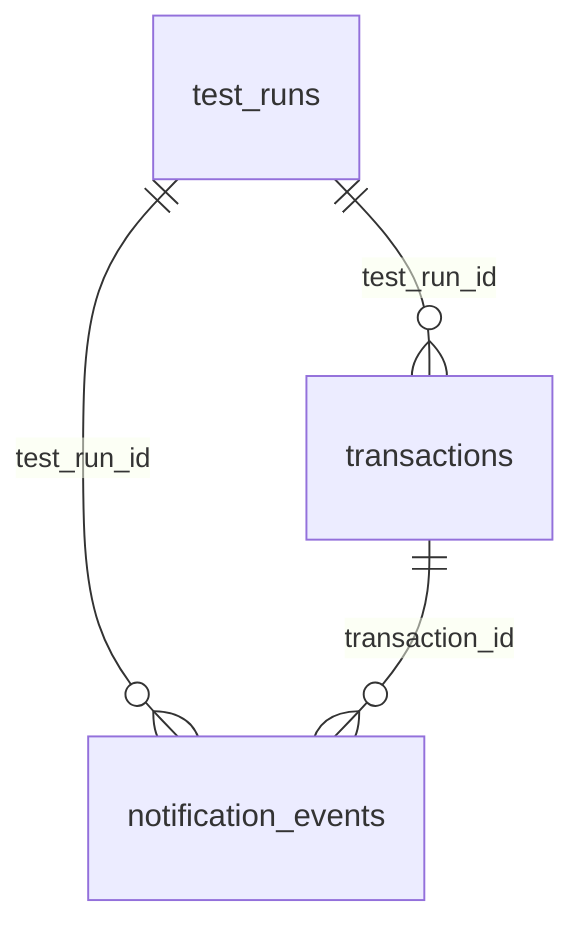

# Database schema

Inspected read-only on 30 October 2026 against the tracked `fintech_analyzer.db` and compared with SQLAlchemy models in `backend/app/models/`. SQLite schema below is actual stored schema, not an assumed relational design.

## Initialization and persistence

`core/database.py` creates a synchronous SQLAlchemy engine with `pool_pre_ping=True`; SQLite sets `check_same_thread=False`. SessionLocal uses autocommit=False and autoflush=False. Default URL `sqlite:///./fintech_analyzer.db` resolves relative to process working directory. `main.py` imports models, calls `Base.metadata.create_all` at import, then seeds seven default rates only when the rate table is empty. GET rates also seeds when empty. There are no Alembic scripts or migrations; create_all does not alter existing columns. No explicit SQLite PRAGMA foreign_keys=ON, WAL configuration, retry policy or retention is configured.

Table primary/foreign keys and indexes are declared below. Foreign-key declarations do not prove SQLite enforcement: connection setup does not enable it. No ORM relationship/cascade objects are defined. Business statuses/currency enums are strings, not database CHECK constraints. Defaults/timestamps mostly come from SQLAlchemy Python-side defaults and therefore may appear null in SQLite server-default metadata.



`exchange_rates` is an independent lookup table; transaction exchange_rate is a stored financial snapshot string, not a foreign key.

## test_runs

| Column | SQLite type | NOT NULL | Primary key ordinal | Server default |
|---|---|---|---|---|
| id | VARCHAR(36) | True | 1 | None |
| name | VARCHAR(100) | True | 0 | None |
| status | VARCHAR(20) | False | 0 | None |
| transaction_count | INTEGER | True | 0 | None |
| workload_type | VARCHAR(20) | False | 0 | None |
| processing_mode | VARCHAR(20) | False | 0 | None |
| concurrency_limit | INTEGER | False | 0 | None |
| intl_percentage | FLOAT | False | 0 | None |
| random_seed | INTEGER | False | 0 | None |
| config_snapshot | JSON | False | 0 | None |
| created_at | DATETIME | False | 0 | None |
| started_at | DATETIME | False | 0 | None |
| completed_at | DATETIME | False | 0 | None |
| progress | FLOAT | False | 0 | None |
| processed_count | INTEGER | False | 0 | None |
| metrics | JSON | False | 0 | None |
| bottlenecks | JSON | False | 0 | None |
| error_details | TEXT | False | 0 | None |

Foreign keys:

```json
[]
```
Indexes/unique constraints:

```json
[
  {
    "seq": 0,
    "name": "ix_test_runs_id",
    "unique": 0,
    "origin": "c",
    "partial": 0,
    "columns": [
      {
        "seqno": 0,
        "cid": 0,
        "name": "id"
      }
    ]
  },
  {
    "seq": 1,
    "name": "ix_test_runs_status",
    "unique": 0,
    "origin": "c",
    "partial": 0,
    "columns": [
      {
        "seqno": 0,
        "cid": 2,
        "name": "status"
      }
    ]
  },
  {
    "seq": 2,
    "name": "sqlite_autoindex_test_runs_1",
    "unique": 1,
    "origin": "pk",
    "partial": 0,
    "columns": [
      {
        "seqno": 0,
        "cid": 0,
        "name": "id"
      }
    ]
  }
]
```
Actual DDL:

```sql
CREATE TABLE test_runs (
	id VARCHAR(36) NOT NULL, 
	name VARCHAR(100) NOT NULL, 
	status VARCHAR(20), 
	transaction_count INTEGER NOT NULL, 
	workload_type VARCHAR(20), 
	processing_mode VARCHAR(20), 
	concurrency_limit INTEGER, 
	intl_percentage FLOAT, 
	random_seed INTEGER, 
	config_snapshot JSON, 
	created_at DATETIME, 
	started_at DATETIME, 
	completed_at DATETIME, 
	progress FLOAT, 
	processed_count INTEGER, 
	metrics JSON, 
	bottlenecks JSON, 
	error_details TEXT, 
	PRIMARY KEY (id)
);
```

## transactions

| Column | SQLite type | NOT NULL | Primary key ordinal | Server default |
|---|---|---|---|---|
| id | VARCHAR(36) | True | 1 | None |
| test_run_id | VARCHAR(36) | True | 0 | None |
| customer_id | VARCHAR(36) | True | 0 | None |
| transaction_type | VARCHAR(20) | True | 0 | None |
| source_currency | VARCHAR(3) | True | 0 | None |
| destination_currency | VARCHAR(3) | True | 0 | None |
| original_amount | VARCHAR(30) | True | 0 | None |
| exchange_rate | VARCHAR(30) | False | 0 | None |
| converted_amount | VARCHAR(30) | False | 0 | None |
| fx_fee | VARCHAR(30) | False | 0 | None |
| status | VARCHAR(20) | False | 0 | None |
| fraud_flagged | BOOLEAN | False | 0 | None |
| fraud_reason | VARCHAR(255) | False | 0 | None |
| created_at | DATETIME | False | 0 | None |
| started_at | DATETIME | False | 0 | None |
| completed_at | DATETIME | False | 0 | None |
| total_duration_ms | FLOAT | False | 0 | None |
| payment_duration_ms | FLOAT | False | 0 | None |
| fraud_duration_ms | FLOAT | False | 0 | None |
| fx_duration_ms | FLOAT | False | 0 | None |
| notification_duration_ms | FLOAT | False | 0 | None |
| error_message | VARCHAR(255) | False | 0 | None |

Foreign keys:

```json
[
  {
    "id": 0,
    "seq": 0,
    "table": "test_runs",
    "from": "test_run_id",
    "to": "id",
    "on_update": "NO ACTION",
    "on_delete": "NO ACTION",
    "match": "NONE"
  }
]
```
Indexes/unique constraints:

```json
[
  {
    "seq": 0,
    "name": "ix_transactions_customer_id",
    "unique": 0,
    "origin": "c",
    "partial": 0,
    "columns": [
      {
        "seqno": 0,
        "cid": 2,
        "name": "customer_id"
      }
    ]
  },
  {
    "seq": 1,
    "name": "ix_transactions_transaction_type",
    "unique": 0,
    "origin": "c",
    "partial": 0,
    "columns": [
      {
        "seqno": 0,
        "cid": 3,
        "name": "transaction_type"
      }
    ]
  },
  {
    "seq": 2,
    "name": "ix_transactions_destination_currency",
    "unique": 0,
    "origin": "c",
    "partial": 0,
    "columns": [
      {
        "seqno": 0,
        "cid": 5,
        "name": "destination_currency"
      }
    ]
  },
  {
    "seq": 3,
    "name": "ix_transactions_id",
    "unique": 0,
    "origin": "c",
    "partial": 0,
    "columns": [
      {
        "seqno": 0,
        "cid": 0,
        "name": "id"
      }
    ]
  },
  {
    "seq": 4,
    "name": "idx_tx_testrun_type",
    "unique": 0,
    "origin": "c",
    "partial": 0,
    "columns": [
      {
        "seqno": 0,
        "cid": 1,
        "name": "test_run_id"
      },
      {
        "seqno": 1,
        "cid": 3,
        "name": "transaction_type"
      }
    ]
  },
  {
    "seq": 5,
    "name": "idx_tx_testrun_status",
    "unique": 0,
    "origin": "c",
    "partial": 0,
    "columns": [
      {
        "seqno": 0,
        "cid": 1,
        "name": "test_run_id"
      },
      {
        "seqno": 1,
        "cid": 10,
        "name": "status"
      }
    ]
  },
  {
    "seq": 6,
    "name": "ix_transactions_fraud_flagged",
    "unique": 0,
    "origin": "c",
    "partial": 0,
    "columns": [
      {
        "seqno": 0,
        "cid": 11,
        "name": "fraud_flagged"
      }
    ]
  },
  {
    "seq": 7,
    "name": "ix_transactions_test_run_id",
    "unique": 0,
    "origin": "c",
    "partial": 0,
    "columns": [
      {
        "seqno": 0,
        "cid": 1,
        "name": "test_run_id"
      }
    ]
  },
  {
    "seq": 8,
    "name": "ix_transactions_source_currency",
    "unique": 0,
    "origin": "c",
    "partial": 0,
    "columns": [
      {
        "seqno": 0,
        "cid": 4,
        "name": "source_currency"
      }
    ]
  },
  {
    "seq": 9,
    "name": "ix_transactions_status",
    "unique": 0,
    "origin": "c",
    "partial": 0,
    "columns": [
      {
        "seqno": 0,
        "cid": 10,
        "name": "status"
      }
    ]
  },
  {
    "seq": 10,
    "name": "sqlite_autoindex_transactions_1",
    "unique": 1,
    "origin": "pk",
    "partial": 0,
    "columns": [
      {
        "seqno": 0,
        "cid": 0,
        "name": "id"
      }
    ]
  }
]
```
Actual DDL:

```sql
CREATE TABLE transactions (
	id VARCHAR(36) NOT NULL, 
	test_run_id VARCHAR(36) NOT NULL, 
	customer_id VARCHAR(36) NOT NULL, 
	transaction_type VARCHAR(20) NOT NULL, 
	source_currency VARCHAR(3) NOT NULL, 
	destination_currency VARCHAR(3) NOT NULL, 
	original_amount VARCHAR(30) NOT NULL, 
	exchange_rate VARCHAR(30), 
	converted_amount VARCHAR(30), 
	fx_fee VARCHAR(30), 
	status VARCHAR(20), 
	fraud_flagged BOOLEAN, 
	fraud_reason VARCHAR(255), 
	created_at DATETIME, 
	started_at DATETIME, 
	completed_at DATETIME, 
	total_duration_ms FLOAT, 
	payment_duration_ms FLOAT, 
	fraud_duration_ms FLOAT, 
	fx_duration_ms FLOAT, 
	notification_duration_ms FLOAT, 
	error_message VARCHAR(255), 
	PRIMARY KEY (id), 
	FOREIGN KEY(test_run_id) REFERENCES test_runs (id)
);
```

## exchange_rates

| Column | SQLite type | NOT NULL | Primary key ordinal | Server default |
|---|---|---|---|---|
| id | INTEGER | True | 1 | None |
| source_currency | VARCHAR(3) | True | 0 | None |
| destination_currency | VARCHAR(3) | True | 0 | None |
| rate | FLOAT | True | 0 | None |
| is_active | BOOLEAN | False | 0 | None |
| updated_at | DATETIME | False | 0 | None |

Foreign keys:

```json
[]
```
Indexes/unique constraints:

```json
[
  {
    "seq": 0,
    "name": "sqlite_autoindex_exchange_rates_1",
    "unique": 1,
    "origin": "u",
    "partial": 0,
    "columns": [
      {
        "seqno": 0,
        "cid": 1,
        "name": "source_currency"
      },
      {
        "seqno": 1,
        "cid": 2,
        "name": "destination_currency"
      }
    ]
  }
]
```
Actual DDL:

```sql
CREATE TABLE exchange_rates (
	id INTEGER NOT NULL, 
	source_currency VARCHAR(3) NOT NULL, 
	destination_currency VARCHAR(3) NOT NULL, 
	rate FLOAT NOT NULL, 
	is_active BOOLEAN, 
	updated_at DATETIME, 
	PRIMARY KEY (id), 
	CONSTRAINT uq_pair UNIQUE (source_currency, destination_currency)
);
```

## notification_events

| Column | SQLite type | NOT NULL | Primary key ordinal | Server default |
|---|---|---|---|---|
| id | VARCHAR(36) | True | 1 | None |
| test_run_id | VARCHAR(36) | True | 0 | None |
| transaction_id | VARCHAR(36) | True | 0 | None |
| status | VARCHAR(20) | False | 0 | None |
| worker_id | INTEGER | False | 0 | None |
| queued_at | DATETIME | False | 0 | None |
| processed_at | DATETIME | False | 0 | None |
| wait_time_ms | FLOAT | False | 0 | None |
| processing_time_ms | FLOAT | False | 0 | None |
| error_message | VARCHAR(255) | False | 0 | None |

Foreign keys:

```json
[
  {
    "id": 0,
    "seq": 0,
    "table": "transactions",
    "from": "transaction_id",
    "to": "id",
    "on_update": "NO ACTION",
    "on_delete": "NO ACTION",
    "match": "NONE"
  },
  {
    "id": 1,
    "seq": 0,
    "table": "test_runs",
    "from": "test_run_id",
    "to": "id",
    "on_update": "NO ACTION",
    "on_delete": "NO ACTION",
    "match": "NONE"
  }
]
```
Indexes/unique constraints:

```json
[
  {
    "seq": 0,
    "name": "ix_notification_events_status",
    "unique": 0,
    "origin": "c",
    "partial": 0,
    "columns": [
      {
        "seqno": 0,
        "cid": 3,
        "name": "status"
      }
    ]
  },
  {
    "seq": 1,
    "name": "ix_notification_events_test_run_id",
    "unique": 0,
    "origin": "c",
    "partial": 0,
    "columns": [
      {
        "seqno": 0,
        "cid": 1,
        "name": "test_run_id"
      }
    ]
  },
  {
    "seq": 2,
    "name": "idx_notif_testrun_status",
    "unique": 0,
    "origin": "c",
    "partial": 0,
    "columns": [
      {
        "seqno": 0,
        "cid": 1,
        "name": "test_run_id"
      },
      {
        "seqno": 1,
        "cid": 3,
        "name": "status"
      }
    ]
  },
  {
    "seq": 3,
    "name": "ix_notification_events_transaction_id",
    "unique": 0,
    "origin": "c",
    "partial": 0,
    "columns": [
      {
        "seqno": 0,
        "cid": 2,
        "name": "transaction_id"
      }
    ]
  },
  {
    "seq": 4,
    "name": "ix_notification_events_id",
    "unique": 0,
    "origin": "c",
    "partial": 0,
    "columns": [
      {
        "seqno": 0,
        "cid": 0,
        "name": "id"
      }
    ]
  },
  {
    "seq": 5,
    "name": "sqlite_autoindex_notification_events_1",
    "unique": 1,
    "origin": "pk",
    "partial": 0,
    "columns": [
      {
        "seqno": 0,
        "cid": 0,
        "name": "id"
      }
    ]
  }
]
```
Actual DDL:

```sql
CREATE TABLE notification_events (
	id VARCHAR(36) NOT NULL, 
	test_run_id VARCHAR(36) NOT NULL, 
	transaction_id VARCHAR(36) NOT NULL, 
	status VARCHAR(20), 
	worker_id INTEGER, 
	queued_at DATETIME, 
	processed_at DATETIME, 
	wait_time_ms FLOAT, 
	processing_time_ms FLOAT, 
	error_message VARCHAR(255), 
	PRIMARY KEY (id), 
	FOREIGN KEY(test_run_id) REFERENCES test_runs (id), 
	FOREIGN KEY(transaction_id) REFERENCES transactions (id)
);
```

## Storage semantics and model defaults

TestRun.id and Transaction.id are UUID strings assigned by application code. ExchangeRate.id is an autoincrement integer. NotificationEvent.id is a string primary key with no generated default; the current worker never inserts records.

TestRun requires id/name/transaction_count; schema validation controls input bounds. Python defaults: QUEUED, mixed, concurrent, concurrency=50, intl_percentage=50, seed=42, UTC created_at, progress=0, processed_count=0. Config_snapshot stores only supplied service dictionaries, not full effective defaults/rates/environment; API response omits this column. Metrics and bottlenecks are JSON blobs (not normalized metric tables). started_at/completed_at/error_details are optional.

Transaction financial fields original_amount/exchange_rate/converted_amount/fx_fee are VARCHAR(30), preserving the Decimal output representation; unlike the misleading source comment, these are not floating point columns. Required original_amount, customer/type/currencies and test_run_id have no DB-level positivity/currency validity constraints. Defaults: PENDING, fraud_flagged=false, created_at UTC, durations=0. Optional result/risk/error fields use nullable columns. Normal engine results overwrite status/timestamps/timings. notification_duration_ms remains 0 in the current pipeline.

ExchangeRate enforces unique (source_currency,destination_currency) with uq_pair; rate is FLOAT and non-null, not exact Decimal storage. Python defaults: is_active=true and updated_at UTC, with onupdate timestamp. No positive-rate or supported-code DB checks exist.

NotificationEvent defaults: QUEUED, queued_at UTC, wait_time_ms=0 and processing_time_ms=0. worker_id/processed_at/error_message are nullable. Its foreign keys link run and transaction, but there is no enforced uniqueness for one event per transaction. The historical table has zero rows.

Runs are inserted QUEUED before work, updated RUNNING/progress periodically, and finally COMPLETED with metrics/findings after processing. Engine persists transactions in separate committed batches of 1,000 after timed processing/drain. This is not a single atomic experiment write; interruption can produce partial records/stale status. Failure handler writes FAILED/error_details where possible but lacks robust DB rollback/recovery. Rate upserts commit immediately. PUT system config changes memory, not a database config table.

The tracked audit contains 13 runs and 10,360 transactions, with counts matching each run; see database_audit.json. No schema or benchmark data was changed by this audit. SQLite is writable on hosting only when its parent directory is writable. Default Render storage is ephemeral; runtime rows do not survive filesystem replacement. Persistent disk or a separately planned PostgreSQL migration is needed for durable hosting. Concurrent writers can contend because SQLite serializes writes. See DEPLOYMENT.md for operational constraints and backup/transfer choices.
