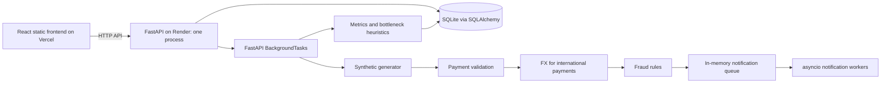

# FinTech System Load & Scalability Analyzer with Foreign Exchange Support

Audit date: 30 October 2026, Asia/Kolkata. This package describes inspected code and local verification, not a completed cloud deployment. Read the accompanying API, schema, requirements and testing files plus raw evidence. Older README descriptions are not independent proof.

## Problem statement and objectives

**How can a FinTech payment system handle increasing transaction loads without significant delays?**

Demonstrate: generate synthetic transactions → process → increase workload → measure processing time → display graphs → identify bottlenecks → increase simulated capacity → compare configurations. Workload choices include 100, 500, 1,000, 5,000 and 10,000 transactions. Objectives cover bounded concurrency, fraud rules, FX overhead/caching, asynchronous notification capacity, throughput/tail latency, history and exports. The project does not implement a real payment gateway or actual money movement.

## Architecture and stack

React 19.3.1 / TypeScript / Vite 8.3.5, Tailwind CSS, Recharts and lucide-react; npm lockfile. FastAPI with `backend.app.main:app`, Uvicorn, Pydantic/settings, synchronous SQLAlchemy, SQLite, psutil and openpyxl. Runtime versions verified locally: Python 3.11.9 and Node 22.19.0. Dependency specifications are in `backend/requirements.txt` and `frontend/package.json`; exact frontend resolutions are in the npm lockfile.



Services are Python classes inside one application, not independent network microservices. Concurrent processing means asyncio tasks sharing an event loop, not multiple CPUs/hosts. No broker, Redis, real FX feed or notification provider is configured. SQLite is accessed only by the backend.

## Repository organization and components

See `evidence/source_inventory.txt` for the full inspected source inventory. Main structure:

```text
backend/
  requirements.txt
  app/main.py                  application, import-time schema creation and rate seed
  app/core/{config,database}.py
  app/api/routes.py            HTTP handlers
  app/models/                 TestRun, Transaction, ExchangeRate, NotificationEvent
  app/schemas/schemas.py       API validation/response models
  app/services/
    benchmark_runner.py       per-run services and background execution
    load_generator.py         seeded synthetic workloads
    payment_engine.py         pipeline, progress, persistence and orchestration
    fx_service.py             illustrative rates, cache, inverse lookup, Decimal math
    fraud_service.py          amount, velocity and probabilistic rules
    notification_service.py   in-memory queue and worker metrics
    metrics_collector.py      aggregates and percentile interpolation
    bottleneck_analyzer.py    threshold rules and recommendations
    export_service.py         CSV and two-sheet XLSX
  tests/test_fintech_system.py eight tests
frontend/
  package.json, package-lock.json, vite.config.ts, vercel.json
  src/App.tsx                 stateful tab shell, backend availability banner
  src/services/api.ts          centralized configurable API/export prefix
  src/pages/                  eight pages listed below
  src/components/             Navbar, StatCard, StatusBadge
  src/types/                  frontend response types
scratch/run_benchmarks.py      existing HTTP benchmark suite
scratch/verify_deployment.py   new isolated local HTTP verification
fintech_analyzer.db            tracked historical SQLite data, preserved
DEPLOYMENT.md                  full deployment procedure
documentation_context/        seven context files and supporting evidence
```

The UI has Overview, Run Load Test, Performance Analytics, Bottleneck Analysis, Experiment Comparison, FX Analytics, Transaction Explorer and System Config. It uses local state tabs, not React Router. Reloading returns to Overview. Charts visualize saved experiment aggregates, not live service traces. Polling: app/overview approximately every 3 seconds; submitted experiment approximately every 600 ms. History selectors request the newest 50 runs by default; API supports pagination up to 100. Transaction explorer supports paginated status/type/customer filters. Loading and empty states exist; error handling is uneven. A global backend-unavailable warning was added; some pages still retain stale/empty values and only log individual failures. Browser interaction tests have not been run.

## Data and processing workflow

POST `/api/test-runs` validates the top-level workload (10–50,000 transactions, concurrency 1–500), saves a QUEUED run and schedules a FastAPI background task. The task creates fresh services for that run and generates an entire batch in memory. Seeded Python random controls customer/amount/currency choices; UUIDs and execution timings are not deterministic. Default pool: 200 customers. Domestic amounts are usually 100–45,000 INR, with a 5% branch generating 260,000–500,000. International amounts are 25–4,500 units, 70% foreign→INR and otherwise INR→foreign. Despite an inline cross-currency comment, the generator does not generate foreign→foreign pairs. Supported currencies include JPY but default JPY rates are absent, so generated JPY transactions can fail.

Payment engine marks RUNNING and starts notification workers. It validates a positive Decimal amount, awaits a simulated payment delay, performs FX for international payments and evaluates fraud unless FX failed. Status is SUCCESS, FLAGGED or FAILED. All statuses are enqueued for notification. Sequential mode awaits each transaction in order. Concurrent mode schedules the whole batch with `asyncio.as_completed` and bounds pipeline entry with a semaphore. Progress is periodically committed. All generated tasks/records remain in memory; only pipeline execution is bounded. Notifications drain before final metrics. Transactions persist in committed batches of 1,000; metrics/bottlenecks persist on TestRun and status becomes COMPLETED. Batch commits are not one atomic experiment transaction.

The admission check looks for RUNNING only and is not atomic; overlapping QUEUED submissions remain possible. `active_engines` exists in memory, but no cancellation endpoint uses it. Errors become failed records/run details; a database commit failure can also break the failure handler because rollback/recovery is incomplete. Jobs and queues do not survive process termination. No startup reconciliation exists for interrupted runs. Normal notification drain and normal Uvicorn shutdown were locally exercised; crash recovery is unimplemented.

## FX workflow and limitations

Rates are illustrative, not current market data: USD/INR 83.25; EUR/INR 89.50; GBP/INR 105.10; SGD/INR 61.80; AED/INR 22.65; USD/EUR 0.93; GBP/USD 1.26. Import seeds these only when the rate table is empty. GET rates also seeds if empty. PUT rates upserts a currency pair.

Every new FXService preloads a dictionary from configured defaults. Enabled cache returns direct default rates before querying the database, so database edits/deactivation of default pairs may not affect processing. On a miss or with cache disabled, a simulated delay precedes active direct/inverse DB lookups; fallback to the default dictionary still occurs. Cache is per run with no TTL, LRU eviction or rate-update invalidation. An inverse rate is quantized to six decimals. Unsupported pairs raise FXConversionError.

For different currencies: rounded gross = original×rate; fee = rounded gross×percentage/100; destination net = gross−fee. ROUND_HALF_UP, two decimal places except JPY uses integer units. The service accepts an explicit fee percentage, but the payment engine never supplies the configured global fee: it uses the method default of 1%. The config UI/API therefore does not actually change pipeline fees. Same-currency payments bypass fees. Financial transaction fields persist as strings; rate-table values persist as floating point. Fraud normalization uses net INR when destination is INR; otherwise it approximates original×83.0, which is not a correct general currency conversion. The client-side FX calculator uses JavaScript floats and returns 1.0 for missing pairs, unlike backend failure behavior; it is illustrative and not authoritative.

## Fraud and notification workflow

Fraud checks await a simulated delay, then test amount strictly greater than threshold, per-customer recent count greater than configured maximum within an inclusive time window, then seeded probabilistic alerts. High-value returns before adding to velocity history. History is in memory per run, not a durable/customer-wide risk profile. Concurrent ordering/timing can change which transactions are flagged despite identical seeds.

Notification workers await an in-memory bounded asyncio queue. Each payload contains transaction/run IDs, status and queued timestamps. Workers record wait and simulated delivery time, success/failure counts and observed peak backlog. They do not send messages or write NotificationEvent rows. The normal drain uses `queue.join()` including in-flight deliveries before stopping workers. Per-transaction `notification_duration_ms` remains 0; aggregate notification metrics reside only in the run JSON.

## Metrics, bottlenecks, comparison and exports

`time.perf_counter` measures service and batch durations. Payment TPS = number of processed records / payment-batch elapsed seconds (includes failed and flagged records, scheduling, enqueue/backpressure and progress commits). Pipeline TPS uses elapsed seconds through notification drain. Neither includes transaction bulk persistence or final metric saving; generation also occurs before the timer. Per-transaction response duration starts after semaphore acquisition and stops before notification enqueue: excludes admission/semaphore wait, notification wait/delivery, persistence and browser/network latency. Latencies are application measurements, not end-to-end API response times. Stage averages for payment/fraud include zero durations for skipped stages; FX averages use all international records, including zero durations on failures. Main percentiles interpolate linearly at `(n−1)×p/100`. Notification and global FX analytics instead use sorted index `int(n×0.95)`; the definitions differ. Values are rounded to two decimals (batch seconds to four).

Success percentage counts SUCCESS only; FLAGGED is a separate fraud count, not a failed payment. FX success means a non-null stored rate, even when later flagged. Notification peak queue is sampled after enqueue, excluding deliveries already taken by workers. Resource metrics are a single process RSS snapshot and host `psutil.cpu_percent(interval=None)` snapshot, not per-run CPU utilization profiling.

Bottleneck rules: fewer than 50 records yields insufficient-data INFO only. Otherwise notification queue >150 or average wait >80 ms yields HIGH; international FX average/overall response average >35% or FX P95 >25 ms yields MEDIUM; P95/average >2.5 yields MEDIUM; at least 500 records with TPS <25 yields HIGH. No rule match yields LOW/balanced. Recommendations are heuristic text; there is no automated scaling or proven root-cause profiling. An LRU-cache recommendation describes a future improvement, not the actual dictionary implementation.

Comparison retrieves matching run IDs without ordering; the first database result becomes the baseline, which need not match the first requested ID. Throughput improvement = (item−baseline)/baseline×100; latency reduction = (baseline−item)/baseline×100, rounded to two decimals; zero baseline produces zero delta. It does not require equivalent configurations or completed status. Thus displayed percentages are descriptive, not controlled causal evidence.

CSV exports all stored records for one run (404 for no records). XLSX exports all completed runs to `Test Summary` and `FX Analysis`; no per-transaction workbook sheet. Both are generated in memory, not persisted server files. API details and exact examples are in API_REFERENCE.md.

## Testing, deployment and future work

Eight existing tests pass after fixing pytest collection; local HTTP checks cover startup, health/docs, both modes, records, exports and CORS. Production build/type check pass; lint exits 0 with 24 warnings. Read TESTING_AND_RESULTS.md for exact outcomes, historical anomalies and evidence limitations.

Target deployment is Vercel static frontend → Render single-process backend → SQLite. No live deployment exists in this session. Default Render storage is ephemeral; retention is not configured. See DEPLOYMENT.md for exact settings and alternatives. No API keys are needed, no secrets or `.env` files were added, no historical data was modified, and no paid database was provisioned.

Future work: controlled repeated 10,000-transaction benchmarks; full effective-configuration/environment snapshots; ordered comparison baselines; correct fee propagation/cache invalidation/missing-pair calculator behavior; validated nested configs; atomic admission; durable queue and restart recovery; authentication/rate limiting; schema migrations and PostgreSQL verification; real external providers only if scope changes; network-inclusive measurements and browser tests. These are proposed enhancements, not implemented features.
